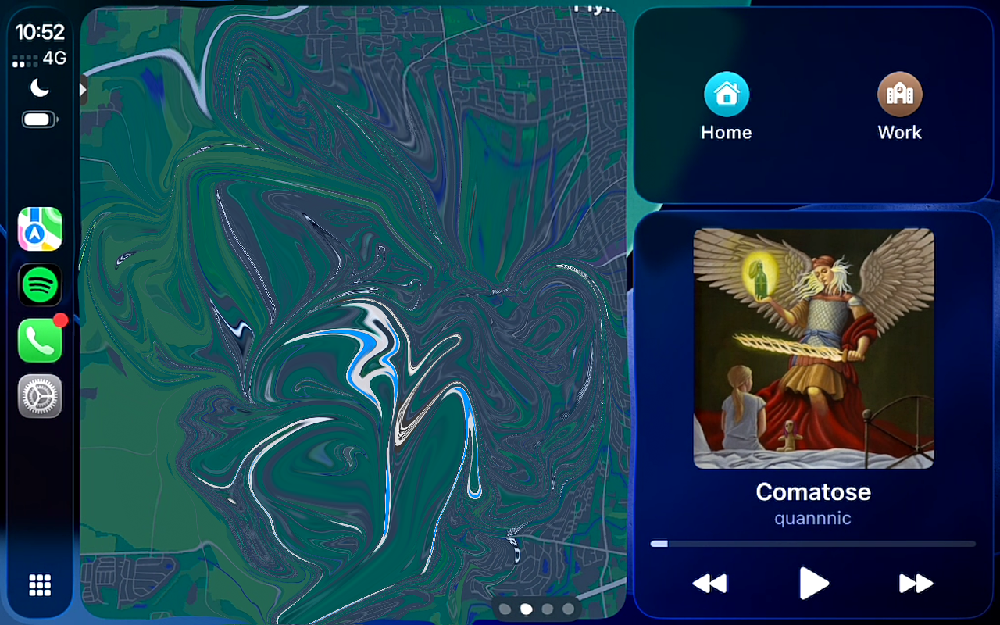
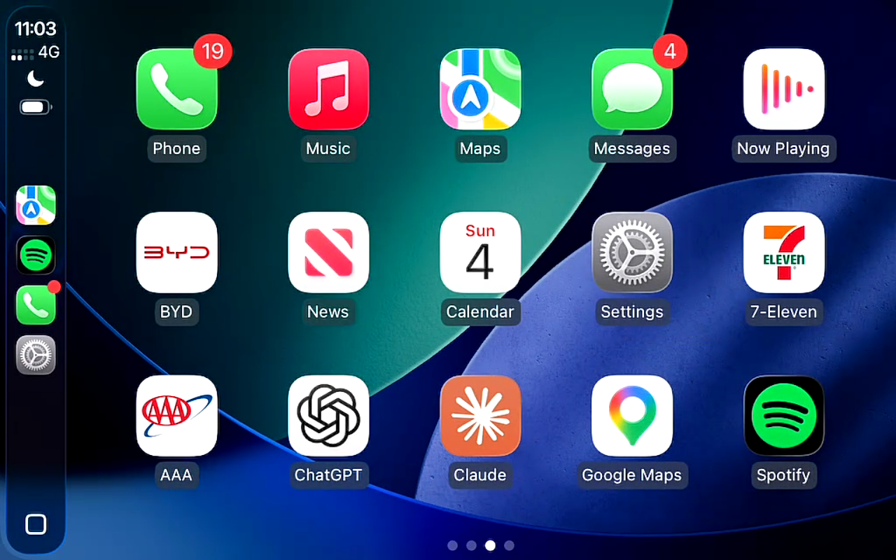
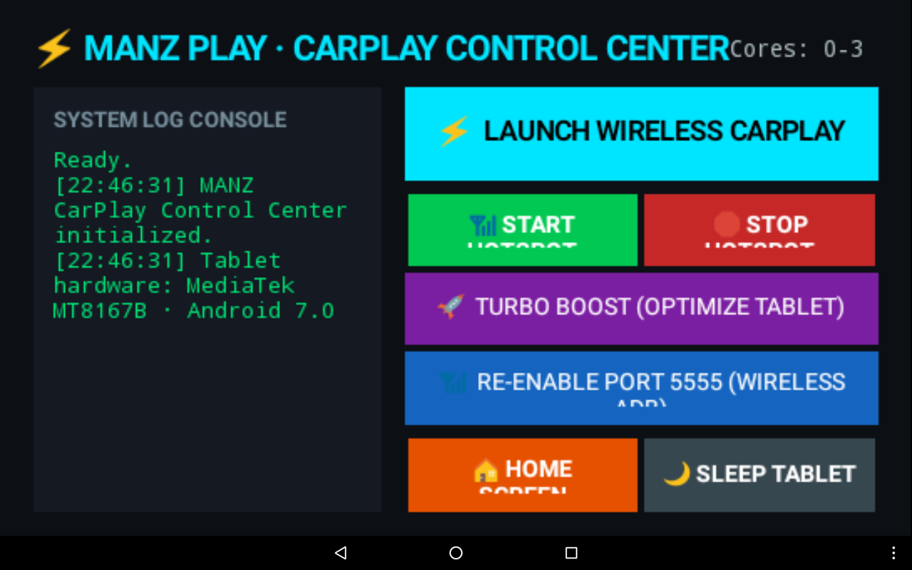

# MANZ CarPlay (AutoCarPlay) ⚡🚗

> **Automotive CarPlay Control Center & Hotspot Automation for Legacy Android Tablets (Android 7.0+ / API 24+)**



## Overview

**MANZ CarPlay (`com.car.autocarplay`)** is an automotive launcher and background daemon engineered to enable **wireless Apple CarPlay on legacy Android tablets** (such as MediaTek MT8167B / Benesse Challenge Pad 3 / Android 7.0 Nougat) connecting to iPhones **without requiring an external USB dongle**.

It manages the Wi-Fi SoftAP access point (`MNZCARPLAY`), bypasses Android 7 kernel network isolation via policy routing injection, optimizes CPU/GPU governor settings, and automatically wakes and launches CarPlay when car power is detected.

---

## Screenshots

| Live CarPlay Dashboard | App Grid |
| :---: | :---: |
|  |  |

| Launcher Control Center UI |
| :---: |
|  |

---

## Features

1. **Auto-Launch on Car Charger Power**:
   - `BootReceiver` and `PowerMonitorService` monitor `ACTION_POWER_CONNECTED` and `BOOT_COMPLETED`.
   - Automatically wakes screen (`FLAG_KEEP_SCREEN_ON` / keyevent 224), sets max brightness, launches SoftAP, applies routing, and starts CarPlay when you start the car engine.
2. **Native SoftAP via Reflection (`TestAp`)**:
   - Invokes `IWifiManager.setWifiApEnabled(WifiConfiguration, boolean)` via root `app_process` to broadcast a dedicated 2.4GHz/5GHz car network (`MNZCARPLAY`).
3. **Android 7 Kernel Policy Routing Injection**:
   - Overcomes Android 7's `32000: unreachable` table rule by injecting priority routes for `table main` and `table 1014`, allowing regular app UIDs to route Bonjour mDNS and IPv6 link-local TCP 7000 connections.
4. **MediaTek MT8167B Turbo Boost**:
   - Terminates non-essential background processes (`Settings`, file explorers, store services).
   - Forces all 4 CPU cores online (`cpu0-3`), tunes cpufreq interactive governor, and reprioritizes `media.codec` and `surfaceflinger` with negative nice values for smooth 60 fps streaming.
5. **Wireless ADB Maintenance**:
   - Keeps ADB port 5555 active for remote wireless debugging and vehicle diagnostics.

---

## Technical Details

- **Target Architecture**: Android 7.0 (API 24), Java 8 Bytecode, DEX format 035/037.
- **Hotspot Subnet**: `192.168.43.1/24`, IPv6 Link-Local `fe80::/64`.
- **DHCP Engine**: Bundled `dnsmasq` instance on `ap0`.
- **CarPlay Backend**: Compatible with DiPlay / xcertplay receiver.

---

## Building from Source

Prerequisites:
- JDK 8 or JDK 17/21
- Android Build-Tools (AAPT, D8, Zipalign, Apksigner)
- Android SDK Platform `android-24` or higher

To build the APK:
```powershell
.\build.ps1
```
The output APK is generated at `MANZCarPlay.apk`.

To install to an attached device:
```powershell
adb install -r MANZCarPlay.apk
adb shell "appops set com.car.autocarplay WRITE_SETTINGS allow"
```

---

## License

This project is licensed under the [GNU General Public License v3.0](LICENSE).
CarPlay is a registered trademark of Apple Inc.
